<div align="center">

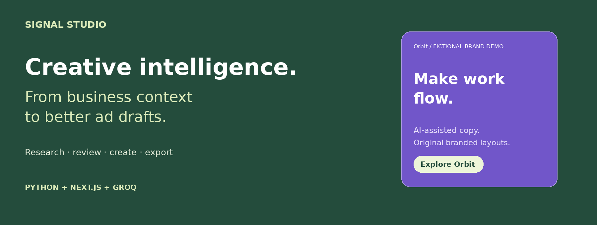

# Signal Studio · Creative Ad Generation

**An AI-assisted creative workspace for research, brand context, original ad layouts and reviewed campaign exports.**

[](https://github.com/Koushik-Biswas/Creative_Ad_Generation/actions/workflows/ci.yml)


[**Open live application**](https://creative-ad-generation.onrender.com) · [**Watch / download demo**](docs/media/Signal_Studio_AI_Demo.mp4) · [**Local setup**](#quick-start) · [**Architecture**](#application-architecture) · [**Production operations**](#production-operations-and-readiness)

</div>

> **Deployment status:** working single-owner application on **Render Free**. The public preview requires a workspace password. Saved campaigns, uploads and rate-limit counters are temporary and reset on restart, redeploy or idle spin-down. Export work before leaving. This release implements the features below; the full [product requirements](docs/PROJECT_REQUIREMENTS.md) include additional capabilities that remain on the roadmap.

## Demo video

[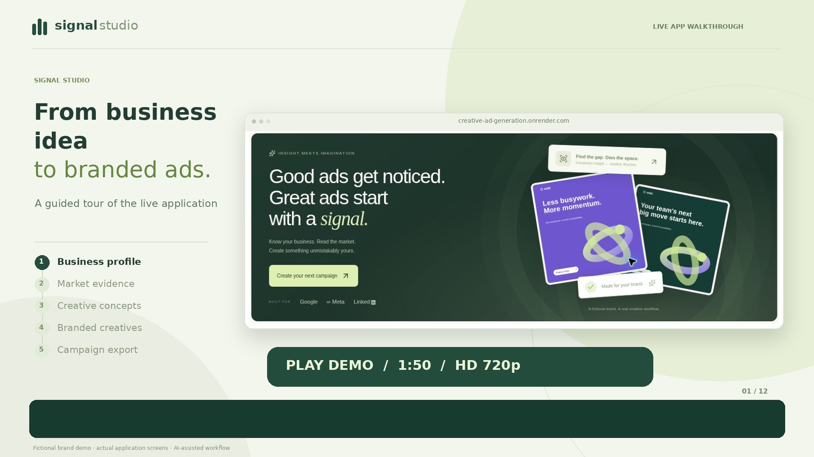](https://github.com/Koushik-Biswas/Creative_Ad_Generation/blob/main/docs/media/Signal_Studio_AI_Demo.mp4)

**1 minute 50 seconds · HD 720p · English synthesized narration and captions.** Click the poster to open the repository video, or [download the MP4](https://github.com/Koushik-Biswas/Creative_Ad_Generation/raw/refs/heads/main/docs/media/Signal_Studio_AI_Demo.mp4). The walkthrough uses actual application screens and a fictional Orbit business. It covers campaign setup, AI research, competitor review, evidence gaps, concept approval, creative generation, editing and export. It contains no workspace password or API key.

## Explore the workspace

| Dashboard | Creative library |
| --- | --- |
| 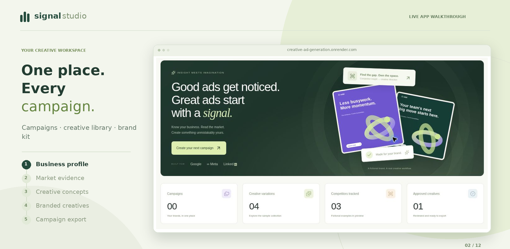 | 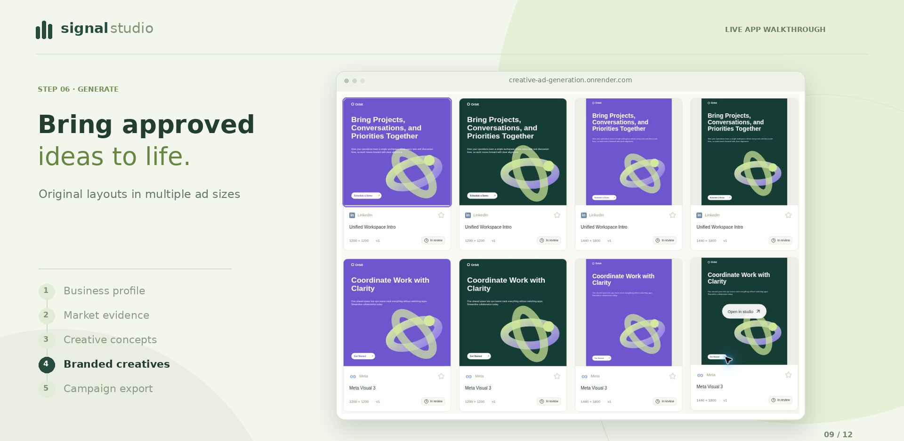 |

| Creative editor | Campaign export |
| --- | --- |
| 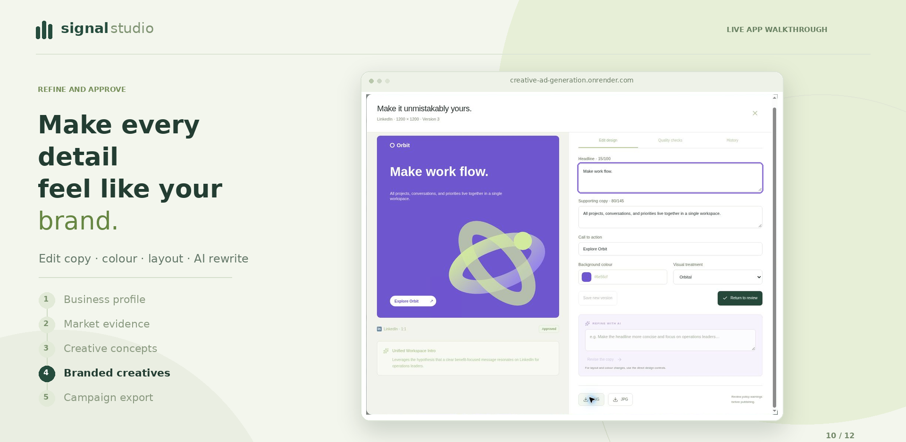 | 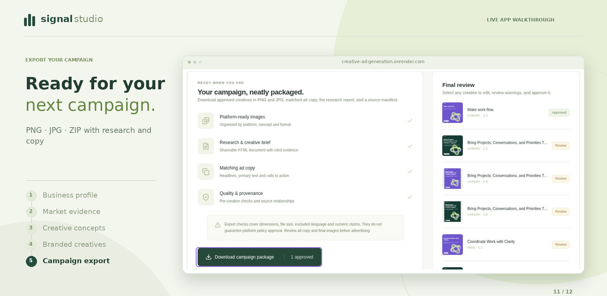 |

## What the application does

| Stage | Implemented behavior |
| --- | --- |
| **Business context** | Public website or manual description; audience, goal, region, language, exclusions and disclaimer. |
| **Brand research** | Bounded HTML acquisition, editable profile, palette and tone; extracted claims retain matching source quotes. |
| **Competitor research** | Model suggestions and manual lists; relationship categories, confirmation, official-library links and source-linked imports. |
| **Insights** | Platform-specific evidence analysis and coverage reporting; insufficient evidence produces explicit hypotheses. |
| **Creative brief** | Structured concepts with headline, supporting copy, CTA, rationale and source references; human concept approval. |
| **Design and iteration** | Original SVG/Pillow graphic layouts, private logo assets, format variations, copy/colour/treatment edits and AI copy revisions. |
| **Review and delivery** | Favourites, approval states, bounded version history, generation-context snapshots, PNG/JPG export and campaign ZIPs. |

The LLM assists with **text and structured decisions**. Image output uses deterministic branded graphic composition. Universal ad scraping, pixel-level ad vision, diffusion photography, agency roles and a drag-and-drop canvas are outside this release. See the complete [implementation matrix](docs/IMPLEMENTATION.md).

## Technology stack

Versions below come from this repository's manifests, rather than claims about the newest available releases.

| Layer | Technology | Role |
| --- | --- | --- |
| Web UI and gateway | Next.js **16.4.3**, React **19.3.1**, TypeScript **5.9.3** | App Router, server-rendered entry points, client dashboard and authenticated API proxy. |
| Web runtime | Node.js **22**; package engine **≥22.13.0** | Production standalone server and local process launcher. |
| Python API | Python **3.12**, FastAPI **0.162.0**, Starlette **1.10.0**, Uvicorn **0.34.2** | Validation, research, orchestration, ownership, rendering and storage. |
| Contracts and HTTP | Pydantic **2.11.4**, HTTPX **0.28.1**, Beautiful Soup **4.13.4** | Typed model output, bounded HTTP acquisition and HTML extraction. |
| Model provider | Groq; default **`openai/gpt-oss-120b`** | Business extraction, competitor suggestions, insights, concepts and copy revision. |
| Images | SVG, browser canvas, Pillow **13.0.0** | Branded composition, preview, raster output and image dimensions. |
| State | SQLite WAL + private local files | Owner-scoped project documents, revisions, metadata and usage counters. |
| Delivery | Multi-stage Docker, Docker Compose, Render | Combined full-stack container; optional split frontend/backend deployment. |
| Verification | Node test runner, pytest **9.1.1**, GitHub Actions | Frontend/core/session tests, API tests, type checks and production build. |

`package-lock.json` locks the npm dependency graph. Python direct dependencies are pinned in [python/requirements.txt](python/requirements.txt); a complete transitive Python lock and image digest pinning remain production supply-chain improvements.

## Application architecture

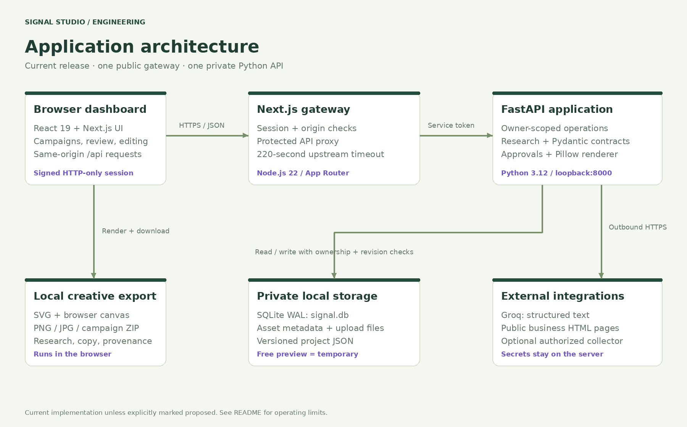

[Editable SVG](docs/assets/architecture.svg)

1. The browser uses the Next.js application and same-origin `/api` routes.
2. Next.js verifies the signed session, checks write-request origins, limits request size and adds the server-held service token and owner identity.
3. FastAPI verifies that token before trusting `X-User-Id`, validates request contracts and checks ownership for stored projects/assets.
4. Python calls Groq and research sources; SQLite and uploaded files remain private to the service.
5. Browser SVG/canvas exports run locally. Python also exposes authenticated Pillow rendering and ZIP endpoints.

**Trust boundaries:** the browser never receives the service token or Groq key. Only Next.js is publicly reachable in the combined container. FastAPI listens on `127.0.0.1:8000`. This is a single-owner workspace, not a multi-tenant identity platform.

## System design and AI orchestration

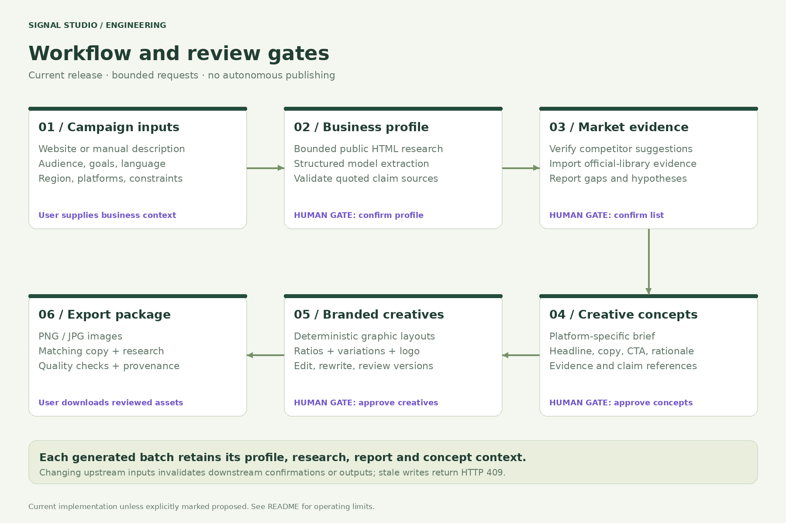

[Editable SVG](docs/assets/system-design.svg)

The workflow is a bounded application pipeline. FastAPI executes work within the request lifecycle; there is no durable task queue, background worker fleet, autonomous browser agent or scheduled ad publishing.

- **Input → profile:** research the home page and up to three relevant same-site pages, optionally supplemented by manual business text. JavaScript-rendered crawling is not implemented.
- **Profile → evidence:** review and confirm the profile, verify suggested competitors, then import exact official-library ad links and observed content. Suggestions come from model knowledge and require verification.
- **Evidence → concepts:** no imported ads means incomplete coverage, not proof that competitors have no ads. Briefs reference supplied evidence/claims and label unsupported directions as hypotheses.
- **Concepts → images:** the user approves concepts, selects ratios and variations, then creates deterministic branded layouts.
- **Images → delivery:** edit/rewrite, review checks, approve final creatives and export. The application does not publish ads to ad networks.

### Model request contract

[agent.py](python/app/agent.py) sends a task, untrusted source context and the required Pydantic JSON schema to Groq in JSON-object mode. Returned JSON is validated against that contract. A validation failure permits **one corrective retry**; each provider call has a **60-second** timeout. Authentication, quota, connection and contract failures become user-facing errors.

Extracted claims are filtered against exact source quotes. Concept evidence/claim references are filtered to known IDs. These controls improve traceability; they do not establish semantic factual accuracy or eliminate prompt injection. Human review remains necessary.

### Change propagation and consistency

Changing upstream business inputs invalidates downstream confirmations, reports or concepts as implemented in the API. Each generated batch stores a snapshot of profile, report, concepts, sources and evidence in `contexts`. Creative edits retain earlier versions. Writes include an expected revision; a competing update returns **HTTP 409** instead of silently overwriting saved work.

## Data model

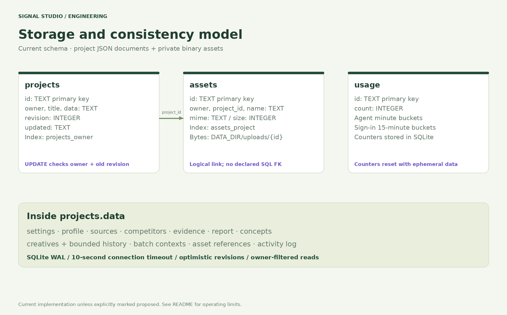

[Editable SVG](docs/assets/data-model.svg) · [Storage implementation](python/app/storage.py)

| Store | Data and consistency |
| --- | --- |
| `projects` | `id`, `owner`, `title`, JSON `data`, integer `revision`, `updated`; owner index and conditional revision updates. |
| `assets` | `id`, `owner`, `project_id`, `name`, `mime`, `size`; project index. `project_id` is an application relationship, not a declared SQL foreign key. |
| `usage` | String bucket ID and count; agent usage and sign-in attempt accounting. |
| `DATA_DIR/uploads/{id}` | Uploaded binary files; access requires the owning workspace through the gateway. |

Project JSON contains settings, profile, sources, competitors, evidence, report, concepts, creatives, contexts, assets and activity history. SQLite uses WAL and a 10-second connection timeout. State is local to one instance; multiple independent replicas would diverge.

## Infrastructure and deployment

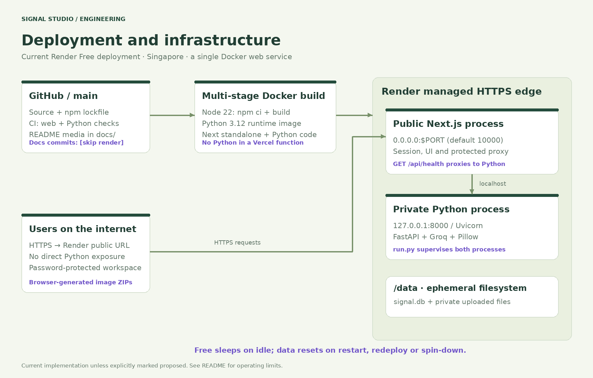

[Editable SVG](docs/assets/infrastructure.svg) · [Deployment guide](DEPLOYMENT.md) · [Dockerfile](Dockerfile) · [Render Blueprint](render.yaml)

| Current live setting | Value |
| --- | --- |
| Public URL | [creative-ad-generation.onrender.com](https://creative-ad-generation.onrender.com) |
| Source | This repository, `main`, repository root |
| Hosting | Render **Free**, Singapore, one Docker web service |
| Frontend bind | `0.0.0.0:$PORT`; container default `10000` |
| Backend bind | `127.0.0.1:8000` inside the same container |
| Readiness endpoint | `GET /api/health` → Python service status |
| Data | `/data/signal.db` and `/data/uploads`; **ephemeral** in the free deployment |
| Process management | `deploy/run.py` starts both processes, forwards termination signals and exits when either process exits |
| Runtime privileges | Launcher initializes the data directory, then drops to UID/GID **10001** before starting application processes |

The root Blueprint sets `plan: free`, has no disk and enables `EPHEMERAL_STORAGE=1`. It specifies `/api/health` as an HTTP health-check path. The current directly created service uses Render's default TCP check; configure the HTTP path in service settings for backend-aware readiness.

Render Free spins down after 15 minutes without inbound traffic, may take about a minute to wake, and loses local files on spin-down, restart or redeploy. Workspace quotas also apply. It is a preview environment, not durable production hosting. [Official Free-plan limits](https://render.com/docs/free).

### Deployment choices

| Option | When to use it | State requirements |
| --- | --- | --- |
| **Render Free / combined Docker** | Public preview and evaluation | Temporary SQLite/uploads; download exports. |
| **Paid disk-capable Render service** | Durable single-instance deployment | Attach `/data`; set `EPHEMERAL_STORAGE=0`; establish backups and restore procedures. |
| **Vercel frontend + separate Python service** | Frontend-specific hosting preference | Configure matching service tokens and backend HTTPS origin; durable Python-side storage required. |
| **External database, object storage and workers** | Future concurrency/availability needs | Requires application changes; proposed below, not currently provisioned. |

The combined Docker image keeps Python dependencies out of Vercel's serverless function bundle. A split deployment must use the Next.js frontend alone on Vercel. See [DEPLOYMENT.md](DEPLOYMENT.md) for its duration and upload limits.

## Quick start

Requirements: **Node.js 22.13+ in the 22 line**, **Python 3.12**, Git, and a Groq API key for live model features. Docker is optional.

```bash
git clone https://github.com/Koushik-Biswas/Creative_Ad_Generation.git
cd Creative_Ad_Generation
npm ci
npm run setup
python3.12 -m venv .venv
.venv/bin/python -m pip install -r requirements.txt
```

Open the generated, ignored `.env.local` privately. Set `GROQ_API_KEY` and choose `WORKSPACE_PASSWORD`; setup generates the remaining local secrets. Then:

```bash
npm run doctor
npm run dev:all
```

Open **http://localhost:3000** and sign in with your local workspace password. The launcher starts both services and uses the repository's `.venv` when available. Windows instructions are in [START_HERE.md](START_HERE.md).

### Run with Docker

After local secret setup:

```bash
docker compose up --build -d
```

The application is available at **http://localhost:3000**. Compose maps only the local loopback interface and uses a named data volume. `docker compose down` stops the app; removing that volume deletes its saved data. Build artifacts, local credentials and documentation media are excluded by `.dockerignore`.

## Environment variables

Keep credentials in ignored local files or hosting environment settings. Never commit live values, put them in screenshots, or prefix them with `NEXT_PUBLIC_`.

| Variable | Purpose | Requirement / default |
| --- | --- | --- |
| `GROQ_API_KEY` | Server-side text-model credential | Required for live LLM stages; no credential bundled. |
| `GROQ_MODEL` | Groq model ID | `openai/gpt-oss-120b`; availability and quotas depend on provider account. |
| `WORKSPACE_PASSWORD` | Single-owner login | At least 12 characters. Read/change it in your own Render Environment settings. |
| `SESSION_SECRET` | HMAC session signing | At least 32 random characters; rotation invalidates existing sessions. |
| `WORKSPACE_ID` | Stable record owner | Defaults to `workspace-owner`; changing it changes which records the session can access. |
| `PYTHON_SERVICE_TOKEN` | Gateway/backend shared secret | At least 32 characters; combined launcher can derive it from `SESSION_SECRET`. |
| `SERVICE_TOKEN` | Python's expected gateway token | Set automatically in combined mode; must match `PYTHON_SERVICE_TOKEN` in a split deployment. |
| `PYTHON_API_URL` | Gateway destination | Combined launcher sets `http://127.0.0.1:8000`; use the backend HTTPS origin when split. |
| `DATA_DIR` | SQLite and private files | `/data` in the combined container. |
| `EPHEMERAL_STORAGE` | Temporary-data notice | `1` for the free preview; `0` only with intentionally durable storage. |
| `PORT` | Public Next.js port | Supplied by Render; container default `10000`. |
| `AD_LIBRARY_API_URL` | Optional authorized collection endpoint | Trusted administrator-configured HTTPS service; absent by default. |
| `AD_LIBRARY_API_KEY` | Optional collector bearer credential | Server only; see [collector contract](docs/COLLECTOR.md). |
| `DEV_AUTH` | Isolated Python test bypass | Keep disabled in deployed services; combined launcher forces `0`. |

## Security model and operational limits

| Control | Implemented behavior | Boundary |
| --- | --- | --- |
| Sessions | HMAC-SHA256 signature, seven-day expiry, owner binding, HTTP-only cookie; `Secure` in production and `SameSite=Strict`. | No SSO, MFA, per-user revocation or team membership. |
| Password comparison | Constant-time comparison of SHA-256 digests of supplied/configured values. | Environment-held shared password, not a user/password database or adaptive password-hash system. |
| API isolation | Next.js session checks; Python constant-time service-token verification; owner-filtered records/assets. | The shared service token is privileged; keep it server-side. |
| Origin handling | Write requests with a mismatched Origin host are rejected. | Requests without Origin are permitted; this is not a general API-client authentication mechanism. |
| Research acquisition | Global public-IP checks, DNS-pinned connections, redirect revalidation, standard HTTP(S) ports, bounded pages and HTML bodies. | No browser-rendered pages; administrator collector configuration is a separate trusted integration boundary. |
| Uploaded assets | Allowed type/signature checks, image verification, size/count limits; SVG upload rejected; authenticated file access. | No malware scanner, object-store retention policy or document understanding pipeline. |
| LLM outputs | JSON/Pydantic validation, bounded corrective retry, source-reference filtering and human approvals. | No guarantee of truth, originality, policy acceptance or immunity to prompt injection. |
| Responses | No-store API responses, content-type safeguards, restricted CSP on asset responses; generic unexpected errors. | No complete application-wide CSP or third-party security audit. |

### Enforced bounds

| Resource | Code-enforced bound |
| --- | --- |
| Gateway request body | **4 MiB**, including multipart overhead |
| Python asset | **5 MiB** per file; **30 assets** per campaign; gateway path remains subject to 4 MiB body limit |
| Campaigns | **100** per owner |
| Competitors / evidence | **10** competitors; **100** evidence entries |
| Creatives / batches | **120** creatives; **20** generation contexts per campaign |
| Project document | **1,800,000 bytes** of serialized JSON |
| History / activity | Last **30** creative versions and **50** activity entries |
| Agent requests | **18 per minute**, per owner |
| Sign-in accounting | At most **8 attempts per fingerprint** and **30 global attempts** per 15-minute bucket |
| Research | Up to **4 website pages**; **1,200,000-byte** HTML body bound; 12-second HTTP timeout per page request |
| Model / gateway | **60 seconds** per model call; **220 seconds** upstream gateway timeout; route declares `maxDuration=240` for compatible serverless hosting |

Buckets are stored in SQLite. On Free, losing the database also resets rate-limit counters. None of these limits constitute a measured throughput or availability SLA.

## Image formats and export contract

| Ratio | Dimensions | Notes |
| --- | --- | --- |
| Square `1:1` | **1200 × 1200** | General image-layout option. |
| Landscape `1.91:1` | **1200 × 628** | Placement compatibility must be checked in the destination ad manager. |
| Portrait `4:5` | **1440 × 1800** | Placement compatibility must be checked. |
| Story `9:16` | **1080 × 1920** | Skipped for LinkedIn; Google needs a compatible placement. |

These are application presets, not a claim that every ad platform accepts every placement. Copy bounds are 100 headline characters, 145 supporting-copy characters and 24 CTA characters; the brief prompt requests shorter headlines/body text.

Browser export produces PNG/JPG and a campaign ZIP with matching copy, a shareable HTML research/brief report, checks and provenance. Python endpoints also provide raster files and a ZIP with images plus JSON copy/checklist and research/provenance. Exact browser/Pillow raster appearance can differ. Final assets and claims require human review before advertising.

## API surface

All project and asset routes require the authenticated gateway; only health is public. `POST /api/auth/attempt` is an internal service-token-protected login guard.

| Method | Route | Purpose |
| --- | --- | --- |
| `POST` | `/api/auth/login`, `/api/auth/logout` | Create/clear browser session. |
| `GET` | `/api/health`, `/api/bootstrap` | Public readiness / authenticated workspace state. |
| `POST` | `/api/projects` | Create campaign. |
| `GET`, `PATCH`, `DELETE` | `/api/projects/{id}` | Owner-scoped read, revision-checked update and deletion. |
| `POST` | `/api/projects/{id}/assets` | Upload private campaign asset. |
| `GET` | `/api/assets/{assetId}` | Read an owned asset. |
| `POST` | `/api/projects/{id}/{action}` | `research`, `suggest-competitors`, `insights`, `brief`, `generate`, `rewrite`. |
| `GET` | `/api/projects/{id}/render/{creativeId}.{png\|jpg}` | Python raster rendering. |
| `GET` | `/api/projects/{id}/export` | Python campaign ZIP; requires an approved creative. |

Common response classes: `400` invalid inputs/gate failures, `401` missing credentials, `403` origin rejection, `404` missing or non-owned resources, `409` stale revision, `413` oversized data, `429` request/provider quota, `502/503` provider or backend failures. FastAPI interactive docs are exposed only in the isolated development-auth configuration.

## Production operations and readiness

### Durable single-instance operation

Use a disk-capable service with `/data` mounted and `EPHEMERAL_STORAGE=0`. Maintain a SQLite-consistent backup procedure, include private asset files, keep the owner ID stable, encrypt backups, define retention and practice restores. A logical campaign export is not a full database/asset recovery mechanism. Avoid multiple replicas against local SQLite/files.

Monitor public and Python health, failed deploys, process restarts, memory pressure, disk growth, request errors and Groq quota/latency. `/api/health` reports service liveness; it does not verify Groq availability or full database read/write readiness. Render logs plus process supervision are present; centralized application metrics, distributed traces and alert policies must be added. Do not log cookies, credentials, provider payloads or private uploads.

For deployment recovery, distinguish source rollback from data restoration. A previous image cannot reverse a database or asset change. Test restore and rollback procedures with representative data. No RPO, RTO, throughput benchmark or availability SLA has been established for this release.

### Proposed production evolution

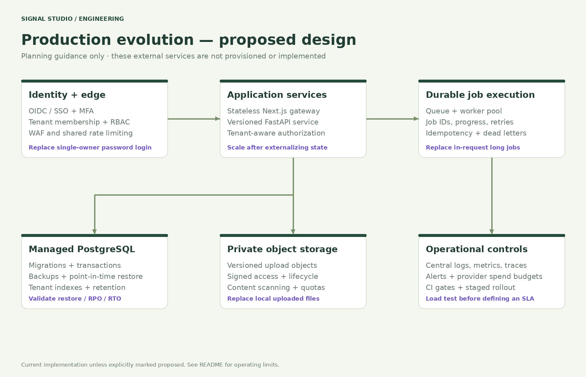

[Editable SVG](docs/assets/production-roadmap.svg)

| Area | Work required before the corresponding production claim |
| --- | --- |
| Multi-user SaaS | OIDC/SSO, MFA, membership, tenant-scoped authorization, roles, audit events and session revocation. |
| Durable horizontal scale | PostgreSQL migrations/transactions, private object storage, consistent tenant boundaries and shared rate limits. |
| Reliable long work | Durable queue/workers, job state, idempotency, retry/backoff policy, cancellation, progress and dead-letter handling. |
| Security assurance | Threat model, secrets rotation, application CSP, upload scanning, dependency/container scanning and independent review. |
| Operational assurance | Structured logs, metrics/traces, alerts, tested backups, restoration drills and staged deployments. |
| Capacity and cost | Load tests, memory profiling, query/index review, provider token/spend limits and documented quotas. |
| Product expansion | Authorized collection/vision integrations, generative photography, richer canvas editing, agency workflows and publishing connectors. |

The diagram is a design proposal. These services are **not** installed, provisioned or implied to be included in the Free preview.

## Verification and CI

```bash
npm ci
npm run typecheck
npm test
npm run build
.venv/bin/python -m pip install -r requirements-dev.txt
.venv/bin/python -m pytest -q
.venv/bin/python scripts/integration_test.py
```

GitHub Actions runs type checking, frontend tests and the production build in a web job, and pytest in a separate Python job. The local integration script is available but is **not currently a CI step**.

Validation performed for the deployed application:

- **5** frontend/core/session tests and **9** Python API tests passed.
- Local gateway integration covered login/session, authentication, research, ownership boundary, stale writes, origins and logout.
- The real Render Docker build reached live status; production HTTP health and authenticated bootstrap passed.
- A live fictional campaign completed Groq business research and concept generation, human approvals, rendering, a 1200 × 1200 PNG and Python ZIP export.
- The video walkthrough exercised browser editing, AI copy revision, versioning, PNG download and the browser campaign-export flow.

These are observed functional checks, not a security audit, performance certification or proof of complete PRD coverage. [Validation notes](BUILD_VERIFICATION.md) retain earlier build observations; check current [CI results](https://github.com/Koushik-Biswas/Creative_Ad_Generation/actions) and deployment logs for subsequent revisions.

## Repository map

| Path | Responsibility |
| --- | --- |
| `app/`, `components/` | Pages, login, dashboard and guided campaign UI. |
| `lib/` | Session/auth, gateway, domain types, SVG composition and browser exports. |
| `python/app/` | API, contracts, Groq orchestration, research, SQLite and Pillow renderer. |
| `python/tests/`, `scripts/` | API tests, frontend tests, setup/doctor/dev launcher and local integration test. |
| `deploy/`, `Dockerfile`, `docker-compose.yml`, `render.yaml` | Combined/split deployment configuration and process supervision. |
| `docs/assets/` | README screenshots, PNG technical diagrams and editable SVG sources. |
| `docs/media/` | Narrated demo MP4 and linked poster. |
| `.github/workflows/ci.yml` | Web and Python validation jobs. |
| `SOURCE_MANIFEST.json` | Source/documentation/media file sizes and SHA-256 integrity inventory; excludes its own hash. |

## Troubleshooting

| Symptom | First check |
| --- | --- |
| First visit is slow | Render Free may be waking after idle. |
| Campaigns disappeared | Free filesystem reset; use durable storage for persistent records. |
| Login fails | Hosting `WORKSPACE_PASSWORD`, backend readiness and matching shared tokens. Never use the Groq key as the login password. |
| Groq rejects a stage | Credential validity, configured model, provider quota and response-contract errors. |
| Research cannot access a site | Public HTTP(S), accessible HTML and standard ports; use a detailed manual description when access is restricted. |
| Competitor report has no ads | Import real evidence or configure an authorized provider; an empty collection is not market-wide absence. |
| Changes conflict | Refresh after HTTP 409 and retry against the newest revision. |
| Vercel bundle or timeout error | Keep Python in its own service, or use the combined Render Docker deployment. |

## Documentation and references

[Original requirements](docs/PROJECT_REQUIREMENTS.md) · [Implementation matrix](docs/IMPLEMENTATION.md) · [Local setup](START_HERE.md) · [Deployment](DEPLOYMENT.md) · [Collector contract](docs/COLLECTOR.md)

Primary references: [Next.js deployment](https://nextjs.org/docs/app/getting-started/deploying), [FastAPI deployment](https://fastapi.tiangolo.com/deployment/), [Groq structured outputs](https://console.groq.com/docs/structured-outputs), [Render Docker](https://render.com/docs/docker), [Render Free limits](https://render.com/docs/free), [Render deploy behavior](https://render.com/docs/deploys), [SQLite WAL](https://sqlite.org/wal.html).

**MIT © 2026 Koushik Biswas.** See [LICENSE](LICENSE).
